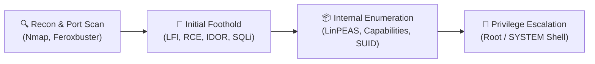

# 🛡️ Hack The Box — Writeups & Lab Portfolio

> Central index of resolved Hack The Box machines, CTF challenges, and offensive security labs.
> Every machine documents the full engagement lifecycle: **Reconnaissance**, **Initial Foothold**, and **Privilege Escalation**.

---

### 📊 Portfolio Summary
- **Total Pwned Targets:** 26 Machines (16 Standalone Machines + 10 Starting Point Foundations)
- **Breakdown:** 6 Medium | 10 Easy | 10 Starting Point (Tier 0 - Tier 2)
- **Operating Systems:** Linux (Debian/Ubuntu/Alpine) & Windows Server / Active Directory
- **Key Methodologies:** OWASP Top 10, Port Scanning & Service Fingerprinting, LFI/RFI PHP Filters, Command Injection, Linux Capabilities, Active Directory Kerberoasting.

---

## 🎯 Main Target Matrix (Standalone Machines)

| Target | OS | Difficulty | Primary Attack Vector & Kill Chain | Writeup Link |
| :--- | :--- | :--- | :--- | :--- |
| **Cohort** | `Linux` | `Medium` | MTU Fragmentation Handling, Grafana Enumeration, SQLite Database Extraction, SUID Exploit | [[Cohort]] |
| **DevHub** | `Linux` | `Medium` | Exposed .git Repository Dumping, Gitea API Token Hijacking, CI/CD Runner Privilege Escalation | [[DevHub]] |
| **Facts** | `Linux` | `Medium` | CMS Made Simple Authenticated SQLi & RCE, SUID Misconfiguration, Sudo Environment Hijacking | [[Facts]] |
| **Nexus** | `Linux` | `Medium` | Sonatype Nexus Repository CVE-2020-10199 EL Injection RCE, Docker Escape / Sudo Abuse | [[Nexus]] |
| **Orion** | `Linux` | `Medium` | MikroTik RouterOS Enumeration, Custom WebApp Vulnerability, Hashcat NTLM Cracking, PrivEsc | [[Orion]] |
| **Principal** | `Windows` | `Medium` | Active Directory Recon, Kerberoasting SPN Extraction, LDAP Enumeration, BloodHound Path Analysis | [[Principal]] |
| **Reactor** | `Linux` | `Medium` | Apache NiFi Processor Creation RCE, JVM Process Extraction, Custom Sudo Binary PrivEsc | [[Reactor]] |
| **Skill Assessment - File Inclusions** | `Linux` | `Medium` | Local File Inclusion (LFI), PHP Filter Wrappers, Apache Log Poisoning to RCE | [[Skill Assessment - File Inclusions]] |
| **2million** | `Linux` | `Easy` | REST API Reversing, ROT13 Invite, Command Injection (VPN .ovpn), Kernel Exploit (Dirty Cred) | [[2million]] |
| **Baggage** | `Linux` | `Easy` | Werkzeug Console PIN Exploit, Flask Debugger, SUID Privilege Escalation | [[Baggage]] |
| **CCTV** | `Linux` | `Easy` | Default Camera API Credentials, Authenticated RCE, Sudo Misconfiguration PrivEsc | [[CCTV]] |
| **Cacti** | `Linux` | `Easy` | Cacti CVE-2022-46169 Unauthenticated Command Injection, Capsh PrivEsc | [[Cacti]] |
| **Cap** | `Linux` | `Easy` | IDOR Network Capture Download, Cleartext Credentials in PCAP, Linux Capabilities (cap_setuid) | [[Cap]] |
| **Connected** | `Linux` | `Easy` | WPA2 Handshake Capture & Cracking, Network Pivoting, System Hardening Bypass | [[Connected]] |
| **Get Simple** | `Linux` | `Easy` | GetSimple CMS 3.3.16 Theme Upload RCE, Sudo Binary Execution Abuse | [[Get Simple]] |
| **Management** | `Linux` | `Easy` | Apache Subversion (SVN) WebDAV Repository Leak, Hardcoded Admin Credentials, Crontab PrivEsc | [[Management]] |

---

## 🏁 Starting Point Lab Series (`write-ups/htb/starting-point/`)

Documented foundation labs covering network protocol enumeration and misconfiguration exploitation across fundamental services:

| Target | Tier | OS | Exploited Vulnerability & Methodology |
| :--- | :--- | :--- | :--- |
| **Meow** | Tier 0 | `Linux` | Unauthenticated Telnet (Port 23) root login bypass |
| **Fawn** | Tier 0 | `Linux` | Anonymous FTP service access (`vsftpd 3.0.3`) sensitive data exposure |
| **Dancing** | Tier 0 | `Windows` | Unauthenticated SMB Null Session share extraction (`smbclient`) |
| **Redeemer** | Tier 0 | `Linux` | Unprotected Redis In-Memory Database (Port 6379) command execution |
| **Appointment** | Tier 1 | `Linux` | Web authentication bypass via SQL Injection (`OR 1=1`) |
| **Crocodile** | Tier 1 | `Linux` | Anonymous FTP credential leak leading to administrative web login |
| **Sequel** | Tier 1 | `Linux` | MariaDB / MySQL remote root authentication without password |
| **Archetype** | Tier 2 | `Windows` | SMB share leak, MSSQL `xp_cmdshell` RCE, PowerShell reverse shell, WinPEAS privesc |
| **Oopsie** | Tier 2 | `Linux` | Burp Suite crawling, IDOR parameter tampering, SUID binary exploitation |
| **Responder** | Tier 2 | `Windows` | PHP LFI to SMB capture, NetNTLMv2 hash harvesting via Responder, John cracking |

---

## ⚡ Methodology: The Modular Kill Chain

1. **Reconnaissance & Fingerprinting:** Deep port scanning, service version detection, and virtual host / directory fuzzing.
2. **Initial Foothold (Access):** Proof-of-Concept exploitation targeting unauthenticated or authenticated web application flaws.
3. **Internal Recon & Escalation:** Local privilege escalation leveraging cron jobs, SUID binaries, misconfigured capabilities, or Active Directory delegations.
